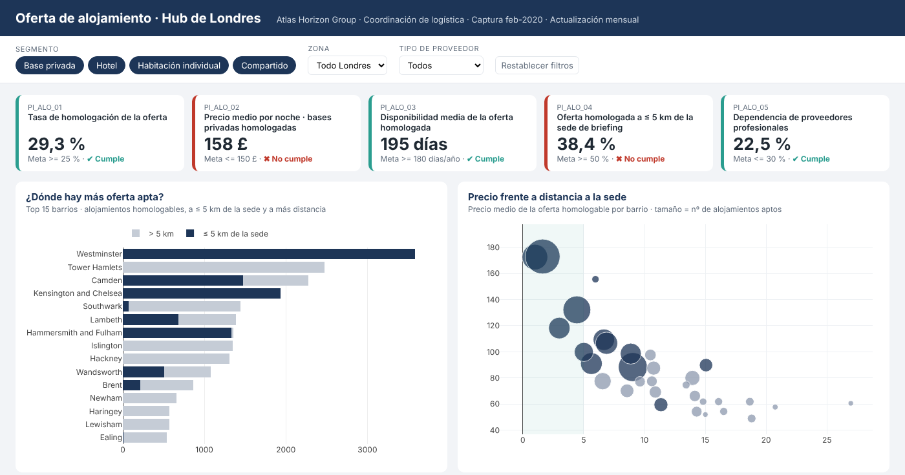
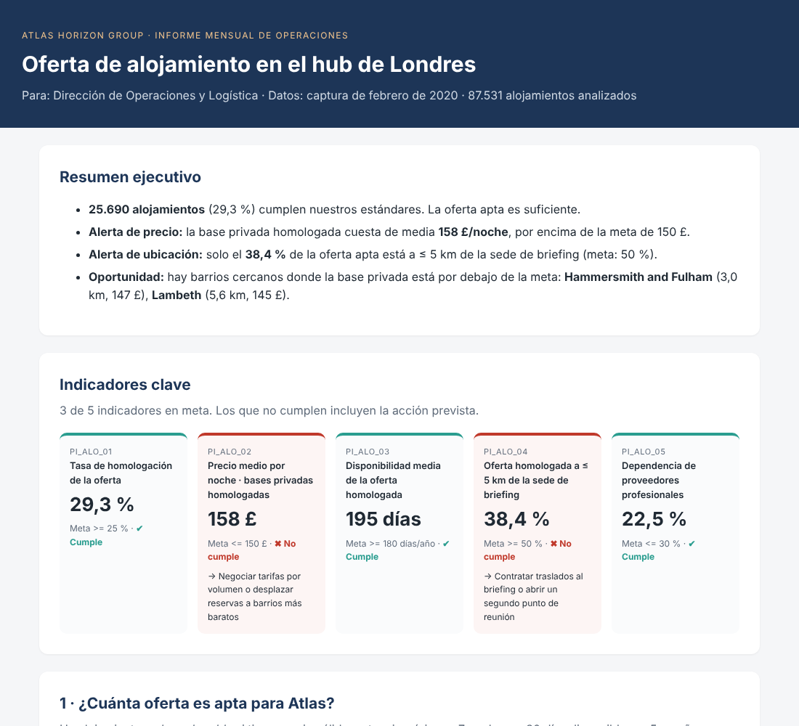
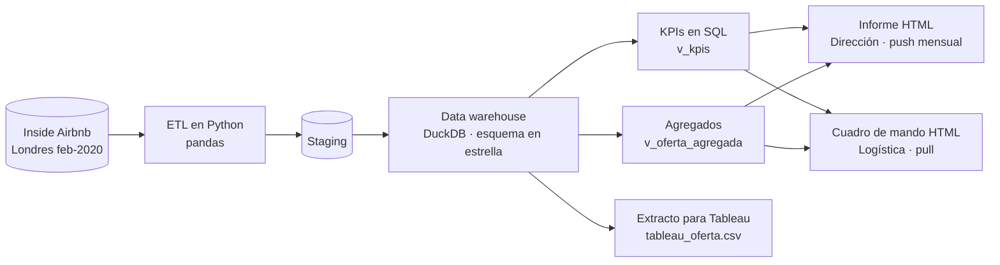

<p align="center"></p>

# Atlas Horizon Group · Proyecto de Business Intelligence

**Proyecto BI de principio a fin:** de la estrategia de negocio de un operador de expediciones de lujo (empresa ficticia) a un data warehouse en SQL, KPIs con metas, un informe ejecutivo y un cuadro de mando interactivo, construidos sobre 87.531 alojamientos reales de Londres.

*End-to-end BI project: business strategy → KPIs → star-schema data warehouse (DuckDB/SQL) → executive report and interactive dashboards (Tableau + HTML).*

`Python` · `pandas` · `SQL` · `DuckDB` · `Tableau` · `Plotly` · `Modelado dimensional (Kimball)`

**[▶ Ver el cuadro de mando](https://brahimnr2003-beep.github.io/atlas-horizon-bi/dashboard/)** · **[📄 Ver el informe de negocio](https://brahimnr2003-beep.github.io/atlas-horizon-bi/reports/informe_oferta_alojamiento.html)** · **[🧭 Documento de diseño](docs/diseno_bi.md)**

> Proyecto realizado en pareja con Raúl Fulgencio Belmonte.
> **Versión 2 rediseñada y ampliada por Brahim Nouni Ros:** integración de ambas fases, data warehouse en SQL, nueva ETL, informe y cuadro de mando.



---

## El problema de negocio

Atlas Horizon organiza expediciones a destinos remotos. Antes de cada salida, clientes y staff pasan de 1 a 3 noches en **Londres** para el *briefing* de seguridad y el vuelo desde Heathrow. El equipo de logística necesita responder a tres preguntas:

1. ¿Qué parte de la oferta de alojamiento cumple nuestros estándares?
2. ¿Cuesta lo que hemos presupuestado?
3. ¿Está lo bastante cerca de la sede de briefing?

## Resultados

| KPI | Valor | Meta | Estado |
|---|---|---|---|
| PI_ALO_01 · Tasa de homologación de la oferta | 29,3 % | ≥ 25 % | ✅ |
| PI_ALO_02 · Precio medio/noche · bases privadas homologadas | 158 £ | ≤ 150 £ | ❌ |
| PI_ALO_03 · Disponibilidad media de la oferta homologada | 195 días/año | ≥ 180 | ✅ |
| PI_ALO_04 · Oferta homologada a ≤ 5 km de la sede | 38,4 % | ≥ 50 % | ❌ |
| PI_ALO_05 · Dependencia de proveedores profesionales | 22,5 % | ≤ 30 % | ✅ |

**Hallazgos clave**
- **25.690 alojamientos** cumplen los criterios de Atlas. El problema no es la cantidad, sino el **precio** y la **ubicación**.
- Los barrios junto a la sede son los más caros: **Westminster (204 £)** y **Kensington and Chelsea (190 £)** por noche en base privada.
- **Hammersmith and Fulham** (3 km, 147 £) y **Lambeth** (5,6 km, 145 £) combinan cercanía y precio dentro de la meta. Son la recomendación principal del informe.



## Qué demuestra este proyecto

| Fase | Trabajo realizado |
|---|---|
| **Análisis de negocio** | Modelo de madurez de Gartner, visión, 4 factores críticos de éxito y 15 KPIs con metas y acciones |
| **Modelado dimensional** | 4 procesos de negocio, matriz bus, dimensiones conformadas, tipos de SCD y tablas de hechos transaccionales y de snapshot |
| **ETL** | Perfilado de calidad, tipos, nulos, duplicados, precios atípicos y recodificación con justificación de negocio |
| **Data warehouse** | Esquema en estrella en **DuckDB** con reglas de negocio en **SQL** (Haversine, percentiles, flags) |
| **Visualización en Tableau** | Historia de Tableau con 8 hojas sobre la oferta de alojamiento y un extracto del data warehouse preparado para Tableau |
| **Reporting** | Informe ejecutivo *push* para dirección y dashboard *pull* para el equipo operativo, cada uno adaptado a su usuario |

## Arquitectura



El modelo en estrella de la tabla de hechos `fact_oferta_alojamiento`, con sus dimensiones tiempo, barrio, segmento y proveedor, está documentado en [`docs/diseno_bi.md`](docs/diseno_bi.md#6-modelos-en-estrella).

## Tableau

- **Historia de Tableau con 8 hojas** sobre la oferta de alojamiento de Londres: [`legacy/dashboard_tableau_v1.twbx`](legacy/). Se abre con Tableau Desktop o Tableau Reader.
- **Extracto para Tableau:** [`data/processed/tableau_oferta.csv`](data/README.md). Tiene una fila por alojamiento con las dimensiones ya unidas y los flags de negocio (`flag_homologable`, `flag_precio_atipico`, `flag_5km`…) calculados en el data warehouse. Un dashboard construido sobre él da los mismos KPIs que el informe y el dashboard HTML.

## Estructura del repositorio

```
atlas-horizon-bi/
├── notebooks/01_eda_etl_data_warehouse.ipynb   ← EDA, ETL, carga del DW y KPIs
├── sql/
│   ├── 01_modelo_estrella.sql                   ← dimensiones, hechos y reglas de negocio
│   └── 02_kpis.sql                              ← KPIs frente a metas y vistas agregadas
├── src/
│   ├── build_report.py                          ← genera el informe de negocio
│   ├── build_dashboard.py                       ← genera el cuadro de mando
│   └── export_tableau.py                        ← exporta el extracto para Tableau
├── reports/informe_oferta_alojamiento.html
├── dashboard/index.html
├── data/
│   ├── raw/                                     ← dataset de origen (ver data/README.md)
│   └── processed/                               ← salidas del DW para informe, dashboard y Tableau
├── docs/
│   ├── diseno_bi.md                             ← diseño completo (Fase 1 revisada)
│   └── fase1_entrega_original.pdf
└── legacy/                                      ← entrega original (v1): notebook y dashboard de Tableau
```

## Cómo ejecutarlo

```bash
pip install -r requirements.txt
jupyter nbconvert --to notebook --execute --inplace notebooks/01_eda_etl_data_warehouse.ipynb
python src/build_report.py
python src/build_dashboard.py
python src/export_tableau.py      # extracto para Tableau
```

El informe y el dashboard cargan Plotly desde su CDN. Para usarlos sin conexión, ejecuta los scripts con `--inline`.

## Decisiones técnicas

- **Tabla de hechos de tipo snapshot periódico.** Los datos son una foto de la oferta en una fecha, no transacciones. El modelo admite capturas mensuales sin cambios.
- **Las reglas de negocio viven en SQL, no en el dashboard.** Así, cualquier herramienta que lea el almacén obtiene las mismas cifras: una única versión de la verdad.
- **Los atípicos se marcan, no se borran.** Precio 0 o por encima del percentil 99 de su tipo → `flag_precio_atipico`. Se excluyen de las medias, pero el dato se conserva para auditoría.
- **`last_review` nulo no se imputa.** Significa "nunca reseñado" y es información de negocio: se usa en el criterio de actividad.
- **Recodificación con justificación de negocio.** El tipo de alojamiento se traduce al **perfil de huésped** de Atlas (cliente UHNW, staff técnico, staff de apoyo). La v1 lo traducía a tipo de expedición sin justificación y dejaba 821 hoteles sin clasificar.
- **Privacidad.** El nombre de los anfitriones no pasa al data warehouse; `dim_proveedor` solo guarda un identificador y el tipo de proveedor.
- **DuckDB** permite tener un data warehouse en SQL analítico sin servidor, gratuito y reproducible en cualquier ordenador.

## Limitaciones y siguientes pasos

- Es una única captura (febrero de 2020, antes de la COVID). El siguiente paso es cargar capturas mensuales para medir la estacionalidad.
- `availability_365` mide los días que el anfitrión abre el calendario, no la ocupación real.
- La sede de briefing y las metas son supuestos del caso de negocio.
- Los procesos 1-3 (ventas, logística, seguridad) están diseñados, pero no implementados porque no hay datos.

## Versión original

La entrega original de la Fase 2 (notebook de Colab y dashboard de Tableau) está en [`legacy/`](legacy/) como referencia. Esta versión 2 reutiliza el dataset y el enfoque de adaptación al negocio, pero rediseña el modelo, la ETL y la visualización.

## Fuente de datos

[Inside Airbnb](http://insideairbnb.com/get-the-data/) · Londres, febrero de 2020 · licencia [CC BY 4.0](https://creativecommons.org/licenses/by/4.0/).
Atlas Horizon Group es una empresa ficticia creada para el proyecto.

---

**Brahim Nouni Ros** · [LinkedIn](https://www.linkedin.com/in/brahim-nouni-ros-data-ia) · [GitHub](https://github.com/brahimnr2003-beep)
