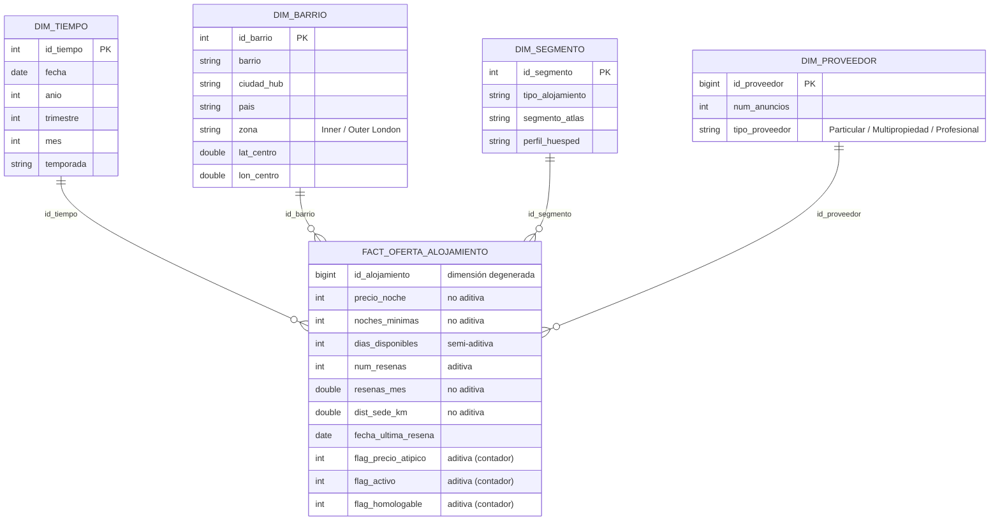
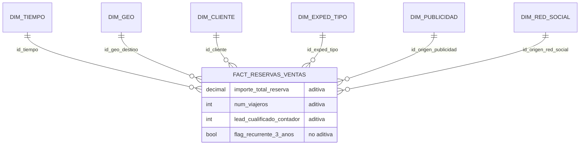
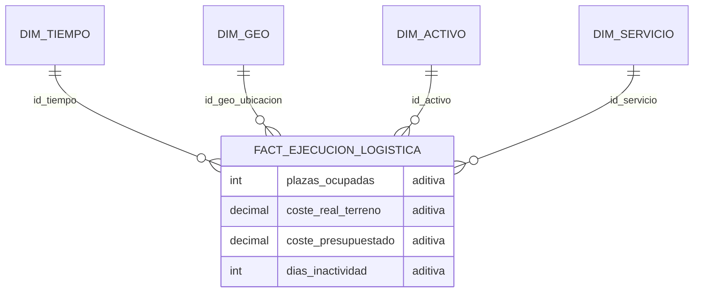
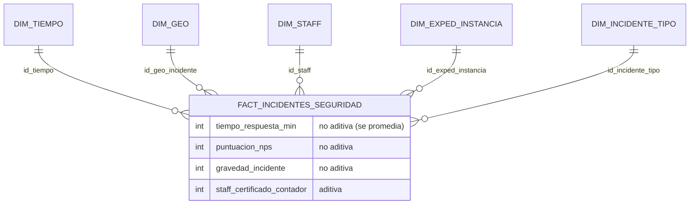

# Diseño BI · Atlas Horizon Group

Documento de diseño del proyecto: análisis de negocio, objetivos, indicadores y modelo dimensional del data warehouse.
Es la versión revisada y ampliada de la Fase 1 original ([PDF](fase1_entrega_original.pdf)).

---

## 1. La empresa

**Atlas Horizon Group** (empresa ficticia) es un **operador global de expediciones de lujo y logística crítica**. No es una agencia que solo vende viajes: es la empresa que los "fabrica" desde cero. Gestiona la infraestructura, el transporte especializado a lugares de difícil acceso y los permisos con gobiernos y autoridades locales.

- **Nicho:** expediciones etnográficas, científicas y de aventura a destinos aislados o políticamente complejos.
- **Clientes:** perfiles UHNW (patrimonio ultra-alto), científicos, fotógrafos y productoras audiovisuales.
- **Inspiración:** National Geographic Expeditions, Ojo de Nómada y la Adventure Travel Trade Association.

| Área de negocio | Alcance |
|---|---|
| **Comercial** · Ventas y clientes | Reservas de alto valor con ciclos de venta de 12-24 meses, pagos multidivisa y segmentación por tipo de expedición |
| **Operativa** · Logística y terreno | Transporte especializado (4x4, avionetas, embarcaciones), suministros críticos, campamentos móviles y **alojamiento en los hubs de partida** |
| **RRHH y Seguridad** | Guías certificados, personal médico, mediadores culturales y protocolos de emergencia |

## 2. Nivel de madurez BI

Según el **Gartner BI Maturity Model**, la empresa está en el **Nivel 2: Oportunista**. Cada departamento tiene sus propias herramientas aisladas: CRM en ventas, hojas de cálculo en logística y documentos en seguridad. No hay data warehouse ni ETL automatizada, así que no existe una "única versión de la verdad".

**Objetivo del proyecto:** pasar al **Nivel 3: Enfocado**, con un data warehouse que centralice la información y unos KPIs comunes para todos los departamentos.

## 3. Visión y prioridades estratégicas

> *Ser el referente mundial en el acceso ético y técnico a las últimas fronteras del planeta.*

1. **Excelencia operativa y logística de precisión**: reducir el desperdicio y los costes imprevistos.
2. **Seguridad proactiva basada en datos**: anticipar riesgos en lugar de reaccionar.
3. **Hiper-personalización para el cliente UHNW**.
4. **Sostenibilidad e integridad cultural**.

## 4. Factores críticos de éxito e indicadores

| CSF | ID | Indicador | Tipo | Meta | Acción si no se cumple |
|---|---|---|---|---|---|
| **CSF 1** · Rentabilidad del segmento UHNW | PI_COM_01 | Ticket promedio por viajero | Rentabilidad | > 15.000 € | Revisar estrategia de precios |
| | PI_COM_02 | Tasa de conversión de leads cualificados | Eficiencia | > 8 % | Formar a los asesores de venta |
| | PI_COM_03 | Índice de recurrencia a 3 años | Fidelidad | > 20 % | Programa de fidelización exclusivo |
| **CSF 2** · Eficiencia de recursos en entornos hostiles | PI_LOG_01 | Ocupación de vehículos y plazas | Operativo | > 85 % | Agrupar clientes en fechas de salida |
| | PI_LOG_02 | Desviación sobre presupuesto logístico | Coste | < 5 % | Auditar proveedores locales |
| | PI_LOG_03 | Días de inactividad de activos | Operativo | < 2 días/año | Mantenimiento preventivo de flota |
| **CSF 3** · Excelencia del staff y seguridad | PI_SAF_01 | Índice de siniestralidad | Calidad | < 1 % | Revisar protocolos y rutas |
| | PI_SAF_02 | NPS post-viaje | Fidelidad | > 70 | Entrevistas a clientes |
| | PI_SAF_03 | Staff con certificación de seguridad vigente | Calidad | 100 % | Bloquear salidas sin certificación |
| | PI_SAF_04 | Tiempo medio de respuesta a emergencias | Calidad | < 45 min | Invertir en comunicación satelital |
| **CSF 4** · Aprovisionamiento eficiente de alojamiento en hubs de partida *(nuevo)* | PI_ALO_01 | Tasa de homologación de la oferta | Calidad | ≥ 25 % | Ampliar plataformas de búsqueda |
| | PI_ALO_02 | Precio medio/noche · bases privadas homologadas | Coste | ≤ 150 £ | Negociar tarifas o cambiar de barrio |
| | PI_ALO_03 | Disponibilidad media de la oferta homologada | Operativo | ≥ 180 días/año | Reservar con más antelación |
| | PI_ALO_04 | % oferta homologada a ≤ 5 km de la sede de briefing | Operativo | ≥ 50 % | Incluir traslados o abrir otro punto de reunión |
| | PI_ALO_05 | Dependencia de proveedores profesionales | Riesgo | ≤ 30 % | Diversificar proveedores |

**¿Por qué un CSF 4?** Antes de cada expedición, clientes y staff pasan de 1 a 3 noches en una ciudad hub (Londres, por la conexión desde Heathrow) para el briefing de seguridad. Un alojamiento caro, mal ubicado o poco fiable afecta al margen y a la primera impresión del cliente. Este CSF es el que se **implementa con datos reales** en la Fase 2.

## 5. Procesos de negocio

| # | Proceso | Tabla de hechos | Tipo | Granularidad | Refresco |
|---|---|---|---|---|---|
| 1 | Gestión de reservas y ventas | `fact_reservas_ventas` | Transaccional | 1 reserva de un cliente para una expedición | Mensual |
| 2 | Ejecución logística y recursos | `fact_ejecucion_logistica` | Transaccional | 1 recurso utilizado × día de expedición | Semanal |
| 3 | Seguridad y desempeño del staff | `fact_incidentes_seguridad` | Transaccional | 1 incidente o 1 encuesta de satisfacción | Diaria / por expedición |
| 4 | **Oferta de alojamiento en hubs** *(implementado)* | `fact_oferta_alojamiento` | **Snapshot periódico** | 1 alojamiento × fecha de captura | Mensual |

### Matriz bus (procesos × dimensiones)

| Proceso | Tiempo | Geo | Cliente | Exped. tipo | Activo | Staff | Incidente tipo | Servicio | Segmento | Proveedor |
|---|:-:|:-:|:-:|:-:|:-:|:-:|:-:|:-:|:-:|:-:|
| 1 · Ventas | ✔ | ✔ | ✔ | ✔ | | | | | | |
| 2 · Logística | ✔ | ✔ | ○ | | ✔ | | | ✔ | | |
| 3 · Seguridad | ✔ | ✔ | ○ | | | ✔ | ✔ | ✔ | | |
| 4 · Alojamiento | ✔ | ✔ | | | | | | | ✔ | ✔ |

✔ = dimensión del hecho · ○ = opcional/degenerada. `DIM_TIEMPO` y `DIM_GEO` son **dimensiones conformadas**: todos los procesos las comparten, y eso permite cruzar datos entre departamentos.

## 6. Modelos en estrella

### Proceso 4 · Oferta de alojamiento *(implementado en `sql/01_modelo_estrella.sql`)*

`DIM_BARRIO` es el nivel más bajo de la jerarquía de la dimensión conformada `DIM_GEO`: Continente > País > Ciudad hub > Barrio.

### Proceso 1 · Reservas y ventas

### Proceso 2 · Ejecución logística

### Proceso 3 · Incidentes y seguridad

## 7. Dimensiones principales

| Dimensión | Compartida | SCD | Técnica de diseño |
|---|---|---|---|
| `DIM_TIEMPO` | Sí (todos) | — | Dimensión conformada |
| `DIM_GEO` / `DIM_BARRIO` | Sí (todos) | Tipo 1 (el riesgo político se sobrescribe) | Dimensión conformada con jerarquía |
| `DIM_CLIENTE` | No (ventas) | Tipo 2 (historial de segmento y país) | — |
| `DIM_ACTIVO` | No (logística) | Tipo 1 | Dimensión de referencia (capacidad máxima) |
| `DIM_STAFF` | No (seguridad) | Tipo 4 (mini-dimensión de certificaciones) | Outrigger para el estado de certificación |
| `DIM_EXPED_TIPO` | No (ventas) | — | Dimensión descriptiva |
| `DIM_SEGMENTO` | No (alojamiento) | — | Recodificación de negocio del tipo de alojamiento |
| `DIM_PROVEEDOR` | No (alojamiento) | Tipo 1 | Banda derivada (tipo de proveedor por nº de anuncios); sin datos personales |

## 8. Cálculo de los indicadores implementados

| ID | Cálculo sobre el modelo |
|---|---|
| PI_ALO_01 | `SUM(flag_homologable) / COUNT(*)` |
| PI_ALO_02 | `AVG(precio_noche)` de los hechos homologables con `segmento_atlas = 'Base privada'` |
| PI_ALO_03 | `AVG(dias_disponibles)` de los hechos homologables |
| PI_ALO_04 | Proporción de hechos homologables con `dist_sede_km <= 5` |
| PI_ALO_05 | Proporción de hechos homologables cuyo proveedor es `Profesional` |

**Regla de homologación.** Un alojamiento es *apto* si cumple todo esto: precio > 0 y ≤ percentil 99 de su tipo, estancia mínima ≤ 7 noches, ≥ 30 días disponibles, ≥ 5 reseñas y una reseña en los últimos 12 meses.

## 9. Cambios respecto a la versión original

- Se añade el **CSF 4 y el Proceso 4**, que conectan el diseño con el dataset de la Fase 2.
- Se añaden los **diagramas en estrella** y la **matriz bus**.
- Se unifican los identificadores `PI_COM_01` (ticket promedio) y `PI_COM_02` (conversión), que estaban cruzados entre la tabla de síntesis y la tabla de cálculo.
- El tiempo de respuesta (TTR) pasa a considerarse **no aditivo**: los tiempos se promedian, no se suman.
